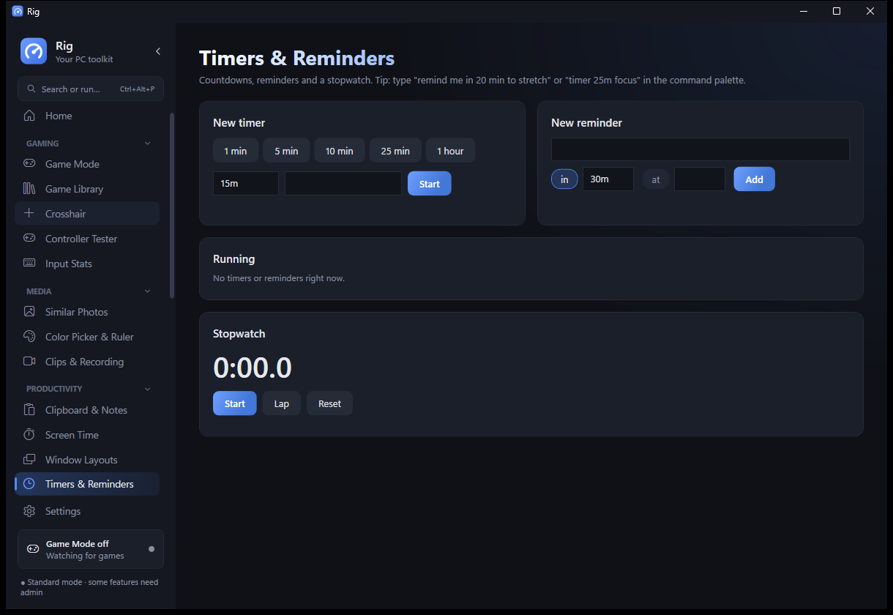
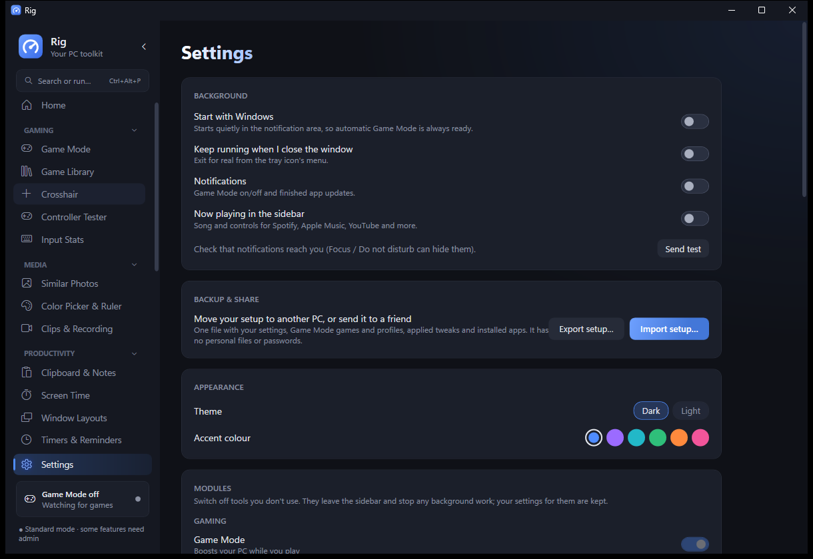

# Rig

Your PC toolkit: a native Windows desktop app (C# / WPF, .NET 10, no third-party packages) that boosts games,
keeps Windows tidy, and handles the everyday stuff, from clipboard history and timers to screen recording,
batch renaming and a colour picker. Formerly **PC Optimizer**. It lives in the notification area, so Game Mode
and your hotkeys are always ready.


| | |
|---|---|
|  |  |
| **Home**: your cards, in dark or light with your accent colour | **Game Mode**: boosts your PC while you play, then undoes everything |
|  |  |
| **Timers & Reminders**, also from the command palette | **Settings**: theme, accent and switching modules on or off |

## Download

Grab an EXE from the [releases](../../releases), for 64-bit Windows 10 and 11:

- **`Rig.exe`** (~75 MB): everything built in. Pick this if you're not sure.
- **`Rig-lite.exe`** (about 1 MB): needs the [.NET 10 Desktop Runtime](https://dotnet.microsoft.com/download/dotnet/10.0) installed.

Run it and a short welcome sets things up and offers to install it (no admin needed: it goes in your user
folder, with a Start menu shortcut and an entry in Windows' "Installed apps" to uninstall it). Or pick
"Portable" and keep running the EXE from wherever it is.

The app updates itself: when a new release is out, Settings → Updates (or the sidebar) offers a one-click update.
Switch on **Beta updates** to get new versions early.

**Coming from PC Optimizer?** It updates itself into Rig. The first start after the update moves the program to
its new folder and renames the shortcuts, the "Installed apps" entry, start with Windows and the maintenance task;
your settings, games, play history and everything else come along.

The EXE isn't code-signed, so the first time you run it Windows SmartScreen may say
"Windows protected your PC". Click **More info → Run anyway**.

## What's inside

Tools are grouped into five categories. Any tool you don't use can be switched off in Settings → Modules: it
leaves the sidebar and stops its background work. Pages only load the first time you open them.

**Home** – a grid of cards you choose and arrange (Customize, or a compact preset): pinned tools (right-click any
sidebar page to pin it), a maintenance check with one-click fixes (junk, startup apps, free space, memory right now,
driver age; a checklist, not a speed test), live CPU and memory, system info, Game Mode, now playing, today's screen time
and input, timers, the power timer, free games and storage.

**Command palette** – Ctrl+Alt+P (or Ctrl+Alt+Space when free) from anywhere: jump to any page or setting, run
actions, launch games and apps, end stuck windows, restore window layouts, control music, and quick answers:
maths, units (`5 ft in cm`), currency (`100 usd to eur`), emoji (`:fire`), time zones (`time in tokyo`) and
reminders (`remind me in 20 min to stretch`, `timer 25m focus`).

### Gaming
- **Game Mode** – turns on when a game from your libraries (Steam, Epic, GOG, Ubisoft, EA, Riot, Xbox, your own
  list) is the window you're using. Optional boosts: top power plan, high CPU priority, no sleep, closing background
  apps (asked to close; force-closing is a separate option); per-game profiles, including their own resolution and
  refresh rate. Each change is recorded before it's made and put back to your original value when the game closes;
  anything that couldn't be restored (even after a crash) is retried on the next start, with a "Try restoring again"
  button. Performance overlay with FPS (admin) and a recap card after each session.
- **Game Library** – every installed Steam, Epic and GOG game with covers and playtime, patch notes, and
  free-to-keep games with optional alerts.
- **Crosshair** – a click-through custom crosshair that turns on in the games you pick (Ctrl+Shift+F8).
- **Controller Tester** – buttons, sticks, triggers, drift check and rumble for XInput controllers.
- **Input Stats** – optional key, click, scroll and cursor-travel counts with keyboard and mouse heatmaps and
  per-game APM. Counts only, never what you type.

### Media
- **Similar Photos** – finds exact copies (ticked for the Recycle Bin, keeping one) and look-alikes such as resized or
  re-saved copies (suggestions only, nothing ticked), with the reason for each match and a keeper you choose.
- **Color Picker & Ruler** – Ctrl+Shift+F7 freezes the screen with a magnifier; click a pixel and its HEX is
  copied (RGB and HSL too). Drag to measure anything in pixels.
- **Clips & Recording** – save the last 30 seconds (Windows Game Bar), screenshots named after the game, and screen
  recording of any area to MP4 or GIF (Ctrl+Shift+F9 / F10 / F11, all changeable).

### Productivity
- **Clipboard & Notes** – Ctrl+Alt+V opens your last 50 copies anywhere; quick notes that save as you type.
- **Screen Time** – time per app per day with optional break reminders.
- **Window Layouts** – save where your windows are and put them back in one click.
- **Timers & Reminders** – countdowns, reminders at a time or after a while (kept across restarts) and a stopwatch.
- **Now playing** – a sidebar mini player for Spotify, Apple Music, YouTube and more.

### Files
- **Downloads** – sorts loose downloads into folders (with undo and optional auto-sorting) and finds old installers.
- **Disk Space** – WizTree-style folder tree and treemap, largest files, duplicates and a tidy-up tab.
- **Junk Cleaner** – temp files, caches, Recycle Bin, shader cache, crash dumps; optional automatic cleaning.
- **Batch Rename** – find and replace, numbering, prefixes, case, with a live preview and undo. Renames and Downloads
  sorts keep a recovery record, never overwrite a file, and anything an undo can't put back is listed in File recovery.
- **Uninstaller** – remove several programs in one go, plus removable Windows extras.

### System
- **Startup Apps**, **Processes**, **Tweaks** (reversible), **Right-click Menu**, **Apps** (winget installs and
  updates), **Hardware** (specs, drive health, benchmarks), **Network** (ping, DNS switcher, speed test),
  **Security** (Defender) and **Tools** (driver check, Windows Update pause, repairs, power timer, maintenance night).

### Settings
Start with Windows, close to tray, notifications, now playing, **privacy & data** (clipboard history, screen time,
input counting, where data lives), **keyboard shortcuts**, **dark or light theme with six accent colours** (Windows'
contrast themes are followed), **modules**, updates (with a beta channel), and backup & share: one file with your
setup, optionally with your personal data. Importing shows a preview where you choose each part, saves your current
setup first, and never switches tracking on without asking.

Deliberately left out: "RAM cleaners" (trimming other apps' memory just makes them page back in from disk)
and registry cleaners (no measurable benefit, real risk).

## Build and run

Needs the [.NET 10 SDK](https://dotnet.microsoft.com/download). From the `Rig` folder:

```
dotnet run -c Release
```

Build both release EXEs into `Release\`:

```
dotnet publish -c Release -r win-x64 --self-contained true -p:PublishSingleFile=true -p:IncludeNativeLibrariesForSelfExtract=true -p:EnableCompressionInSingleFile=true -p:DebugType=none -o ..\Release\full
dotnet publish -c Release -r win-x64 --self-contained false -p:PublishSingleFile=true -p:DebugType=none -o ..\Release\lite
```

Releasing is automated: bump `<Version>` in `Rig/Rig.csproj`, optionally add `docs/release-notes/vX.Y.Z.md`,
then push a `vX.Y.Z` tag. GitHub Actions builds both EXEs (also published as `PCOptimizer.exe` and
`PCOptimizer-lite.exe`, the names PC Optimizer 1.x updates from) and publishes the release. A tag with a suffix,
like `v2.0.0-beta.1`, becomes a pre-release that only beta-channel users are offered. Every push is build-checked.

Tests: `dotnet test Rig.Tests --filter "Category!=Desktop"` runs the domain tests (temporary folders and an isolated
profile only); the `Desktop` category records a few seconds of a screen corner and needs an interactive session.
Performance baseline and thresholds: `docs/PERFORMANCE.md`. Release signing: `docs/SIGNING.md`.

If the app hits an error it shows a report you can copy; logs are in `%AppData%\Rig\logs`.

Settings live in `%AppData%\Rig\settings.json`. Set `RIG_SETTINGS` to another path to use a separate profile
(useful for testing), and `RIG_TEST_INSTALL_ROOT` to try installing, migrating and uninstalling in a sandbox
folder (registry under `HKCU\Software\RigTest`) without touching the real system.
