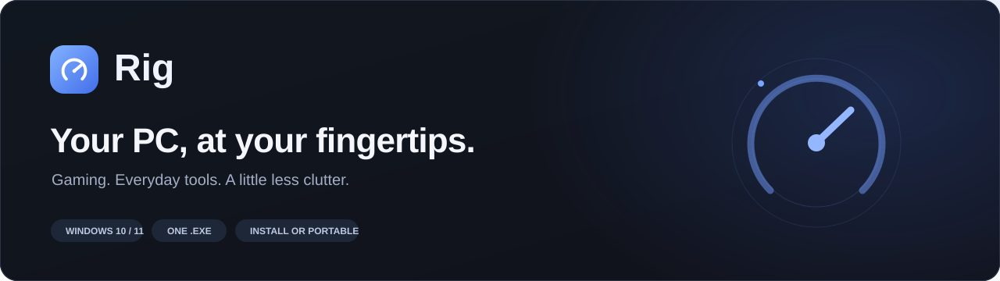
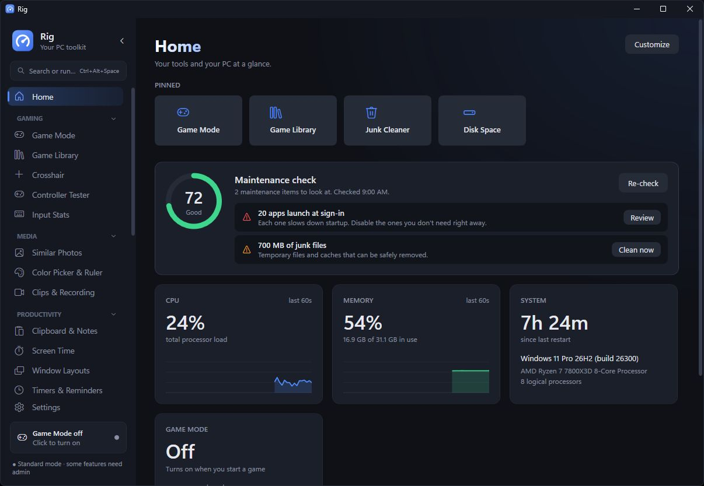
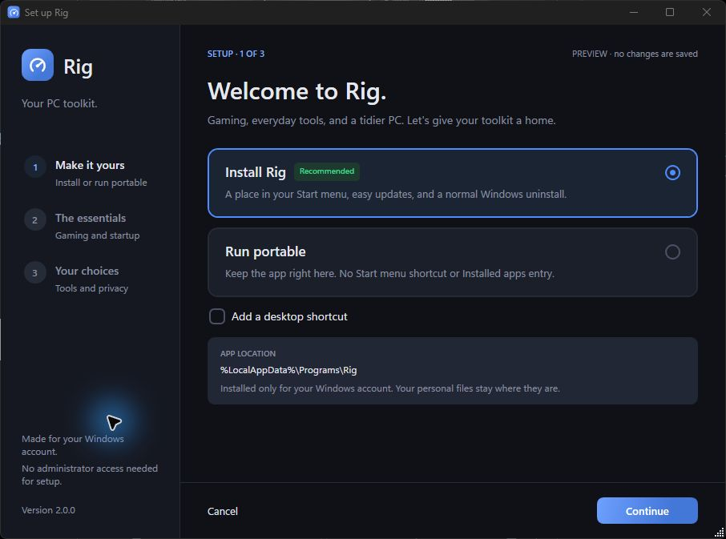
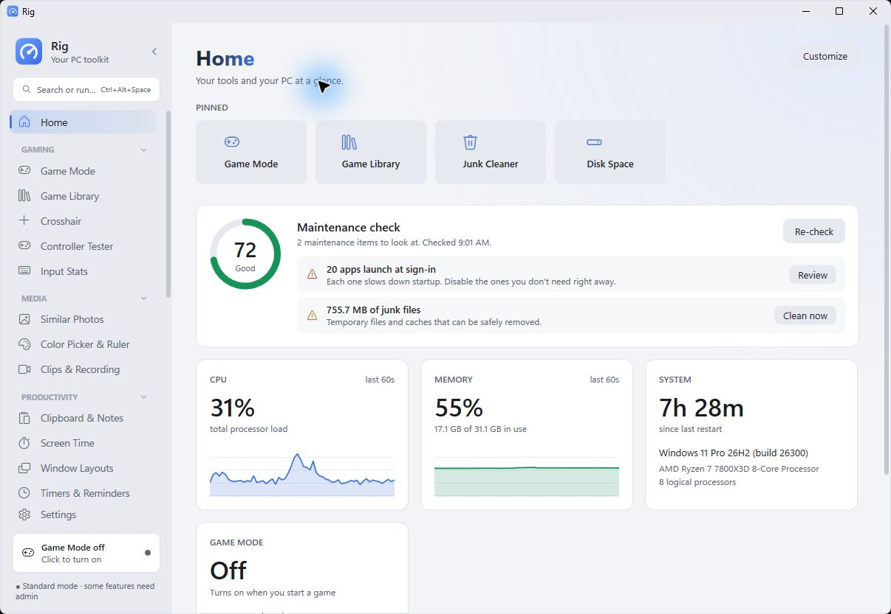

  

  A native Windows toolkit for your games, your files, and the things you do every day.

  

  Windows 10 &amp; 11 · 64-bit · Standalone EXE · Install or run portable 
  <a href="https://github.com/vlyxxxxxq/rig/releases/tag/v2.0.0">Release notes</a> &nbsp;·&nbsp;
  <a href="docs/FEATURES.md">Explore the tools</a> &nbsp;·&nbsp;
  <a href="https://github.com/vlyxxxxxq/rig/issues">Report a problem</a>

---

## A home for your PC tools

**Rig 2.0:** a clearer Home, recent tools for this session, and a redesigned Game Mode with installed-game profiles.

Rig brings gaming controls, maintenance, and everyday utilities into one desktop app. Pin the tools you use,
choose what appears on Home, and switch off the modules you don't need. Keep it in the notification area
for automatic Game Mode, reminders, and shortcuts.

  

Home preview with sample data.

<table>
  <tr>
    <td width="50%" valign="top">
      <h3>Ready when you play</h3>
      
Detect supported games, apply per-game preferences, and track the changes that need to be restored afterward.
      Keep your library, crosshair, controller tester, and session recap close by.

    </td>
    <td width="50%" valign="top">
      <h3>A little less clutter</h3>
      
See where disk space goes, review temporary files, organize Downloads, and rename files in batches.
      Undo and file recovery help you deal with interrupted moves and naming conflicts.

    </td>
  </tr>
  <tr>
    <td valign="top">
      <h3>The everyday stuff, covered</h3>
      
Timers, reminders, quick notes, optional clipboard history, window layouts, a color picker, screenshots,
      and screen recording—without opening a different app for each small task.

    </td>
    <td valign="top">
      <h3>Your setup, your choices</h3>
      
Dark and light themes, six accents, customizable Home cards, optional tracking, and modules you can turn off.
      Your setup and history stay in local files.

    </td>
  </tr>
</table>

## Start in a minute

1. **Download [Rig.exe](https://github.com/vlyxxxxxq/rig/releases/download/v2.0.0/Rig.exe).** One download includes the runtime; no separate .NET installation is needed.
2. **Choose a home.** Install for your Windows account, or keep the EXE where it is and run portable.
3. **Make your choices.** Review Game Mode, sign-in startup, notifications, and the optional clipboard and screen-time tools.
4. **Open Rig.** Pin a few favorites and make Home yours.

Setup doesn't need administrator access. Some system tools ask for it when required.
Clipboard history and screen time start off, and a desktop shortcut is optional.

  

## Find it. Run it. Get back to what you were doing.

Open the command palette with **Ctrl+Alt+P** to find a tool, jump to a setting, launch an app,
or set a timer. Try a few:

| Type | What happens |
|---|---|
| `timer 25m focus` | Start a named countdown |
| `remind me in 20 min to stretch` | Set a reminder |
| `5 ft in cm` | Convert a measurement |
| `Window Layouts` | Jump to your saved arrangements |

Shortcuts are listed in Settings, and capture shortcuts can be changed on their tool pages.

## Built to show you what's happening

- **Game Mode keeps a restoration record.** Applied changes are tracked, failed restores stay pending, and you can retry them.
- **File changes keep a recovery trail.** Renames and Downloads moves are checked against their previews, with conflicts listed for review.
- **Photo suggestions stay suggestions.** Exact duplicates and visual look-alikes are separate. Look-alikes aren't preselected for removal.
- **Maintenance shows its basis.** Storage, startup apps, and current load are checks you can inspect—not a promise of higher FPS.
- **Recording finishes before exit.** Rig waits for the recording file to be finalized when closing or restarting.

<table>
  <tr>
    <td width="50%"></td>
    <td width="50%"></td>
  </tr>
  <tr>
    <td align="center">Game Mode, on your terms.</td>
    <td align="center">A familiar workspace in either theme.</td>
  </tr>
</table>

Interface previews use sample data. Your live readings and installed games will differ.

## Good to know

<strong>Install or portable: where does everything go?</strong>

Installed Rig lives in `%LocalAppData%\Programs\Rig`, with a Start menu shortcut and an Installed apps entry.
Portable keeps the EXE in its current folder and defaults to manual startup.

Both modes save settings and enabled history in `%AppData%\Rig`. Portable does not mean that settings
are stored next to the EXE. Closing the main window normally keeps enabled tools in the tray; choose
**Exit** from the tray menu to quit completely.

<strong>What do the optional tracking tools collect?</strong>

Clipboard history keeps up to 50 text copies in memory and clears when Rig exits. Copies marked private
by their source app are excluded. Screen time records app names and time spent, locally on this PC.
Input Stats counts keys and clicks rather than storing what you type.

Review these choices in **Settings → Privacy & data**. A shareable setup does not turn tracking on without consent.

<strong>Does screen recording include sound?</strong>

The built-in MP4 and GIF recorder captures video without audio. Saving a recent gameplay clip uses Windows Game Bar
and depends on its recording settings.

<strong>Why might Windows show a publisher warning?</strong>

Rig 2.0.0 is not Authenticode-signed, so Windows may show an unknown-publisher or SmartScreen warning.
Download it from this repository's release page and decide whether you trust it before running it.
Release-signing details are documented in [SIGNING.md](docs/SIGNING.md).

<strong>Moving from an earlier build?</strong>

Rig 2.0.0 can update to 2.0.0 from **Settings → Check for updates**. You can also quit Rig from the tray
and replace its EXE with the new download. Your settings are stored separately.

If you used an earlier experimental build already numbered 2.0.0, download this release manually once.
Existing settings and custom Home layouts are retained. The old default layout receives the new Home arrangement.

## Explore or contribute

- [All tools and features](docs/FEATURES.md)
- [Build, test, and preview setup](docs/DEVELOPMENT.md)
- [Rig 2.0.0 release notes](docs/release-notes/v2.0.0.md)
- [Report a bug or request a feature](https://github.com/vlyxxxxxq/rig/issues/new/choose)

Built with **C#**, **WPF**, and **.NET 10**. The application has no third-party runtime packages.
