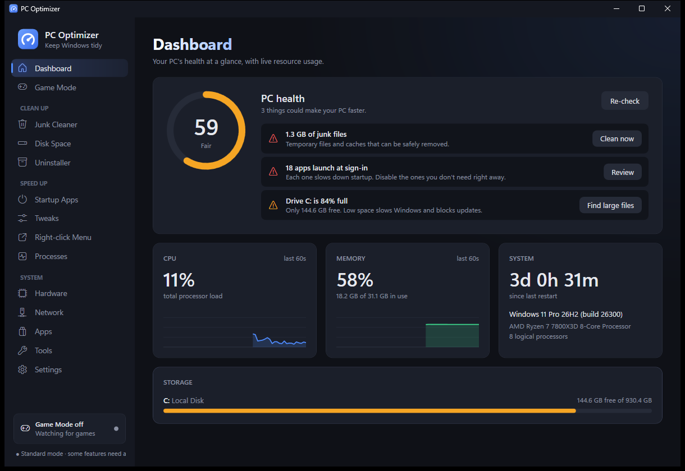
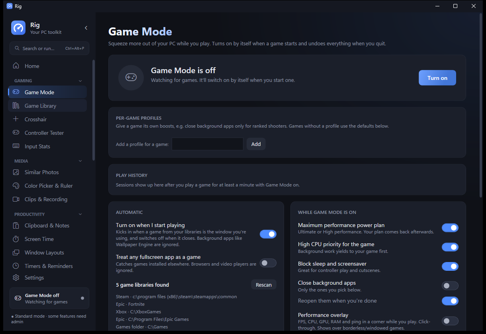
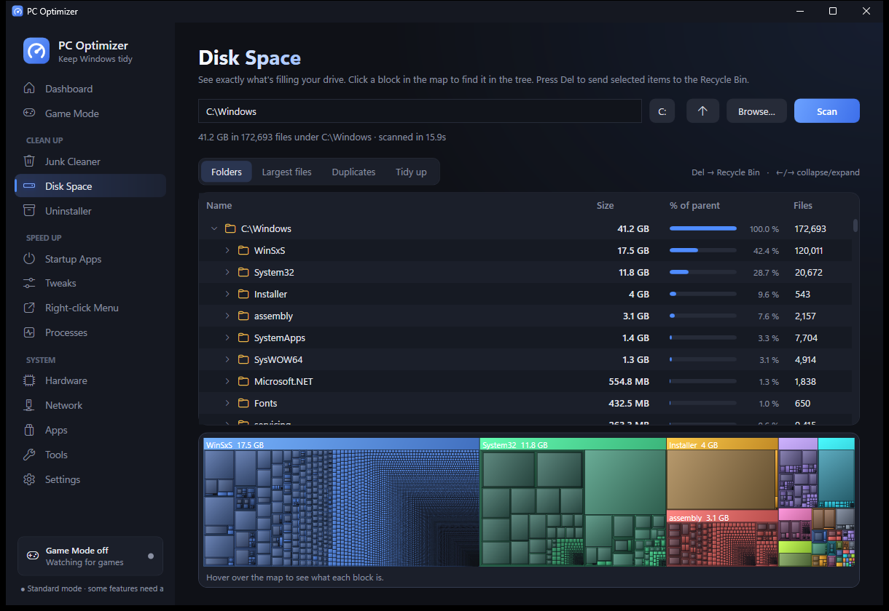
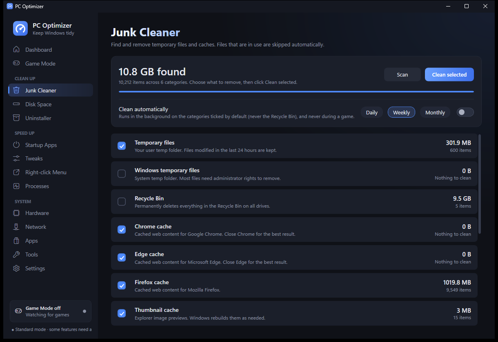
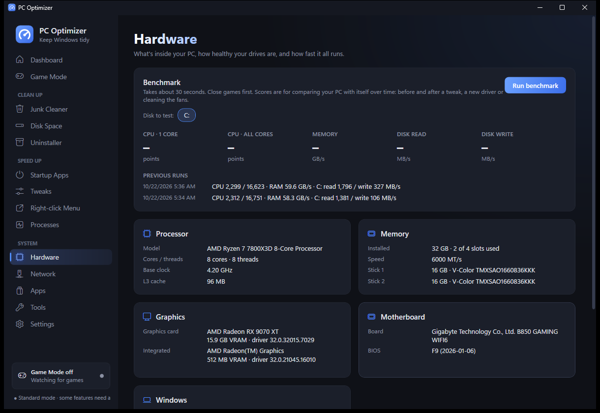
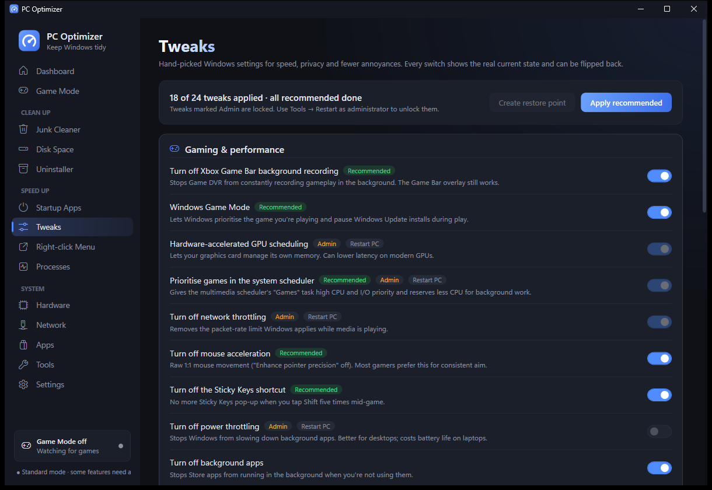

# PC Optimizer

A native Windows desktop app (C# / WPF, .NET 10; the only package is the official Anthropic SDK for Ask AI). Runs in the notification
area so Game Mode can kick in automatically. Inspired by Chris Titus Tech's WinUtil, game boosters
like Razer Cortex and Process Lasso, and Windows' own maintenance tools.



| | |
|---|---|
|  |  |
| **Game Mode**: boosts your PC while you play, then undoes everything | **Disk Space**: WizTree-style tree and treemap, Del to recycle |
|  |  |
| **Junk Cleaner**: caches, temp files, automatic cleaning | **Hardware**: specs, drive health, benchmarks |
|  | |
| **Tweaks**: reversible gaming, privacy and Windows tweaks | |

## Download

Grab an EXE from the [latest release](../../releases/latest), for 64-bit Windows 10 and 11:

- **`PCOptimizer.exe`** (~72 MB): everything built in. Pick this if you're not sure.
- **`PCOptimizer-lite.exe`** (under 1 MB): needs the [.NET 10 Desktop Runtime](https://dotnet.microsoft.com/download/dotnet/10.0) installed.

Run it and a short welcome sets things up and offers to install it (no admin needed: it goes in your user
folder, with a Start menu shortcut and an entry in Windows' "Installed apps" to uninstall it). Or pick
"Portable" and keep running the EXE from wherever it is.

The app updates itself: when a new release is out, Settings → Updates (or the sidebar) offers a one-click update.

The EXE isn't code-signed, so the first time you run it Windows SmartScreen may say
"Windows protected your PC". Click **More info → Run anyway**.

## Features

- **Dashboard** – health score (0–100) on launch with one-click fixes, live CPU/memory charts, drives.
- **Game Mode** – toggle it yourself (page, sidebar chip or tray menu) or let it turn on automatically.
  - Detects games only when one is the window you're using and it lives in a game library
    (Steam incl. all library folders, Epic, GOG, Ubisoft, EA, Riot, Xbox, `X:\Games`) or your own list.
    Background apps such as Wallpaper Engine never count, and known non-game Steam apps (Lossless Scaling,
    SteamVR, Soundpad, Proton…) are filtered out. "Not a game" ignores anything that slips through.
  - Boosts (each optional): Ultimate/High performance power plan, high CPU priority for the game,
    block sleep/screensaver, close background apps and reopen them afterwards.
  - Apps to close: known background hogs that are actually running (sync clients, Teams, torrent clients…)
    with a reason for each, plus one-click adding of any other open app.
  - Everything is undone when the game closes, including after a crash (the old power plan is restored on next launch).
  - Live CPU / GPU / game RAM while you play, and a play history: time per game plus average and peak load per session.
  - Per-game profiles: different boosts for different games.
  - Optional performance overlay: a click-through CPU / GPU / RAM / ping readout in a corner of the screen.
  - Windows notifications when Game Mode turns on or off.
  - Optional FPS counter (with 1% lows) in the overlay for DirectX games, in administrator mode.
- **Game Library** – every installed Steam, Epic and GOG game with cover art and playtime; click to play,
  optionally with Game Mode switched on.
- **Clips & Screenshots** – Ctrl+Shift+F9 (changeable) saves the last 30 seconds (via Windows Game Bar's background
  recording), Ctrl+Shift+F10 saves a screenshot named after the game; a gallery of everything captured.
- **Clipboard & Notes** – Ctrl+Alt+V opens your last 50 copies anywhere (memory only; password-manager copies
  are skipped), plus quick notes that save as you type.
- **Command palette** – Ctrl+Alt+P (or Ctrl+Alt+Space when free) from anywhere: jump to pages, run actions, launch
  games and apps, end stuck windows, quick maths, or ask AI.
- **Ask AI** – questions about your PC answered by Claude using a live snapshot (load, memory hogs, disks, health
  checks). Needs your own Anthropic API key, stored encrypted with Windows DPAPI.
- **Screen Time** – time per app per day and a 7-day chart, counting only active use, with optional break reminders.
- **Junk Cleaner** – temp files, browser caches, Recycle Bin, thumbnails, shader cache, crash dumps.
  Optional automatic cleaning (daily / weekly / monthly), skipped while you're gaming. Browser privacy:
  cookies and history per browser (never passwords, autofill or bookmarks).
- **Disk Space** – WizTree / WinDirStat style: a size-sorted folder tree with "% of parent", a colour treemap
  you can click to jump to a folder, a largest-files list, a duplicate file finder, and a "Tidy up" tab for
  empty folders and broken shortcuts. Select anything and press **Del** to send it to the Recycle Bin
  (Windows and program folders are protected).
- **Network** – live ping graph to any server with jitter and packet loss, DNS speed test across six
  public providers with one-click switching (and back), Cloudflare download speed test. VPN-aware.
- **Hardware** – full specs (CPU, RAM sticks and speed, GPU and VRAM, motherboard, BIOS, Windows), drive
  health, and CPU / memory / unbuffered disk benchmarks with a history to compare before and after changes.
- **Startup Apps** – icons and publishers; reversible enable/disable (same flags as Task Manager), plus
  the scheduled tasks that launch at sign-in, which Task Manager doesn't show. Each item's impact
  (memory and average CPU) is measured so you can see what's worth turning off.
- **Right-click Menu** – switch off the clutter apps add to Explorer's context menu, reversibly.
- **Processes** – live CPU/memory, grouped by app, End task with critical processes protected.
- **Tweaks** – 24 reversible gaming, privacy and Explorer tweaks showing their real current state,
  "Apply recommended", and restore point creation.
- **Apps** – winget-powered: see and install updates for everything, or batch-install popular apps.
- **Uninstaller** – every installed program with icon, size and install date; search, tick several and
  uninstall them in one go with each program's own uninstaller. Plus removable Windows extras (Clipchamp, News, Solitaire…).
- **Tools** – graphics driver check (version, age, one click to AMD / NVIDIA / Intel downloads),
  pause Windows Update for 1–5 weeks, power plans
  (+ add Ultimate Performance), flush DNS, restart Explorer, repair Windows (DISM/SFC, network reset,
  Windows Update fix, chkdsk), shortcuts to Windows tools. Maintenance night: a weekly scheduled clean
  and app-update check that catches up if the PC was off, and skips itself while you're gaming.
- **Security** – Windows Defender status, quick / full scans, definition updates, and game-folder exclusions (admin).
- **Settings** – start with Windows (in the tray), close to tray, notifications, automatic updates, and
  backup & share: export your whole setup to one file and import it on another PC or a friend's.

Deliberately left out: "RAM cleaners" (trimming other apps' memory just makes them page back in from disk)
and registry cleaners (no measurable benefit, real risk).

## Build and run

Needs the [.NET 10 SDK](https://dotnet.microsoft.com/download). From the `PCOptimizer` folder:

```
dotnet run -c Release
```

Build both release EXEs into `Release\`:

```
dotnet publish -c Release -r win-x64 --self-contained true -p:PublishSingleFile=true -p:IncludeNativeLibrariesForSelfExtract=true -p:EnableCompressionInSingleFile=true -p:DebugType=none -o ..\Release\full
dotnet publish -c Release -r win-x64 --self-contained false -p:PublishSingleFile=true -p:DebugType=none -o ..\Release\lite
```

Then rename `Release\lite\PCOptimizer.exe` to `PCOptimizer-lite.exe` when attaching it to a release.
The updater matches on those two asset names.

Releasing is automated: bump `<Version>` in `PCOptimizer.csproj`, optionally add `docs/release-notes/vX.Y.Z.md`,
then push a `vX.Y.Z` tag. GitHub Actions builds both EXEs and publishes the release. Every push to `main`
is also build-checked.

If the app hits an error it shows a report you can copy; logs are in `%AppData%\PCOptimizer\logs`.

Settings live in `%AppData%\PCOptimizer\settings.json`. Set `PCOPTIMIZER_SETTINGS` to another path to use a
separate profile (useful for testing).
